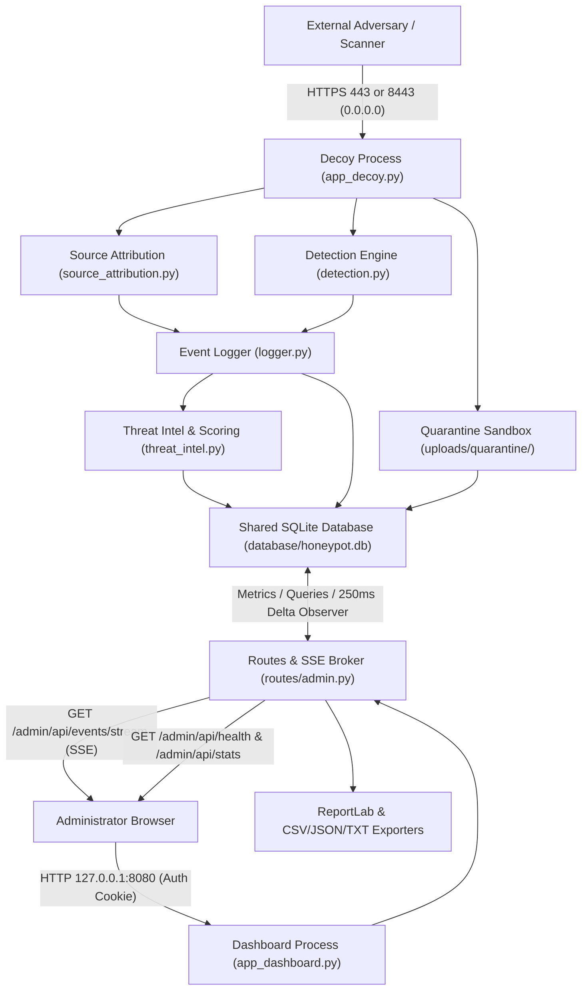

# BAITSCOPE

**Cyber Deception and Threat Intelligence Platform — BAITSCOPE v5.0**

**Deceive. Detect. Investigate.**

[](https://github.com/BlackVenom7405/honeypot/releases/tag/v5.0)

[](#4-technology-stack)

[](#4-technology-stack)
[](#4-technology-stack)
[](#4-technology-stack)
[](#4-technology-stack)
[](#4-technology-stack)
[](#4-technology-stack)
[](#4-technology-stack)
[](#4-technology-stack)
[](#4-technology-stack)
[](#4-technology-stack)
[](#4-technology-stack)
[](#4-technology-stack)
[](#4-technology-stack)

---

## 1. Project Overview

**BAITSCOPE** is a dual-process web honeypot and cyber deception platform built with FastAPI and SQLite. It presents a realistic public-facing web application (`myTunes` decoy streaming service plus legacy deception endpoints) to attract, fingerprint, and trap unauthorized probing while streaming verified threat telemetry to an isolated administrator console.

Unlike monolithic honeypots that expose management interfaces alongside decoy traps, BAITSCOPE physically separates the public attack surface from the operator dashboard while coordinating telemetry, source IP provenance, malware quarantine metadata, and real-time Server-Sent Events (SSE) through a shared SQLite database.

---

## 2. Objectives

- **Deceive Adversaries Safely**: Serve plausible application responses (`myTunes` web player, authentication portals, file uploaders, and API routes) so scanners and attackers continue interacting without tipping off defensive controls.
- **Detect Five Active Attack Vectors**: Inspect normalized inbound requests and uploads for SQL Injection, Cross-Site Scripting (XSS), Path Traversal, Brute Force credential guessing, and Web Shells.
- **Preserve Forensic Integrity**: Quarantine suspicious uploads in an unexecuted directory using canonical filesystem containment checks, SHA-256 digests, bounded reads, and tamper-resistant metadata.
- **Prevent Source IP Spoofing**: Attribute every captured event to its verified TCP socket peer or validated reverse-proxy hop chain before updating threat scores.
- **Deliver Real-Time Operational Visibility**: Push newly captured events instantaneously to authenticated administrators over SSE while monitoring backend reachability independently.

---

## 3. Key Features

- **Web-Based Honeypot and Decoy Environment**: Realistic `myTunes` web application (`/`, `/signup`, `/login`, `/logout`, `/search`, `/create-playlist`, `/upload-avatar`) alongside deception endpoints (`/upload`, `/contact`, `/forgot-password`, `/api/v1/user`, `/client-portal`).
- **SQL Injection Detection**: Multi-pass URL/HTML/comment canonicalization identifying boolean tautologies, UNION queries, blind sleep payloads, stacked queries, and schema introspection.
- **Cross-Site Scripting (XSS) Detection**: Pattern detection covering `<script>` variants, `on*` event handlers, `javascript:`/`vbscript:` URIs, and DOM storage/cookie exfiltration.
- **Path Traversal Detection**: Catches encoded and unencoded directory escapes (`../`, `..\\`, `%2e%2e%2f`), UNIX system files, Windows paths, and UNC share probes.
- **Brute Force Detection**: Tracks repeated invalid authentication attempts per attributed IP (`4+` failures) alongside SQLite-backed rate-limit tracking.
- **Web Shell Detection**: Inspects uploaded filenames and bounded payload bytes for executable web-shell extensions (`.php`, `.jsp`, `.asp`, `.aspx`, `.sh`, `.py`, etc.) and command execution primitives.
- **Persistent Attack Logging**: Stores normalized attack logs, HTTP headers, endpoint targets, severity, timestamps, and provenance fields in SQLite (`attack_logs`) as well as JSON/text logs (`logs/`).
- **Source IP Attribution and Trusted Proxy Handling**: Uses actual socket peers (`request.client.host`) by default and only traverses `X-Forwarded-For` / `X-Real-IP` right-to-left when the immediate TCP peer belongs to `BAITSCOPE_TRUSTED_PROXIES`.
- **IP Threat Scoring and Watchlist**: Maintains a persistent `ip_threat_registry` computing deterministic 0–100 threat scores (severity weight, vector diversity, velocity, volume, recency decay), watchlist flags, and operator notes.
- **Real-Time Attack Monitoring Using SSE**: `GET /admin/api/events/stream` pushes newly persisted intrusions and metric deltas in sub-second latency with monotonic database ID cursors (`Last-Event-ID` replay) and keepalive heartbeats.
- **Configurable Dashboard Update Intervals**: Switch seamlessly between `Real-time` SSE streaming, timed polling intervals (`10s`, `15s`, `30s`, `60s`), `Manual` mode, and an icon-only header manual refresh button, backed by an independent connectivity watchdog.
- **Malware Upload Quarantine and Metadata**: Isolates suspicious uploads inside `uploads/quarantine/` with sanitized timestamped filenames, canonical `realpath`/`commonpath` containment enforcement, `MAX_UPLOAD_SIZE_BYTES` limits, and SHA-256 digests.
- **Administrator Authentication and Access Control**: `PBKDF2-HMAC-SHA256` credential verification and constant-time HMAC-SHA256 signed cookies (`HttpOnly`, `SameSite=lax`) protecting all `/admin` UI and API endpoints.
- **Forensic Report Exports**: On-demand downloads in ReportLab `.pdf`, raw plaintext `.txt`, structured `.json`, and `.csv` formats.
- **Live Attack Monitoring Dashboard**: Collapsible desktop navigation rail, recent event table (`16` rows), 5-vector Chart.js distribution breakdown, event-driven System Radar (idle cleanly between attacks, transient blips on new activity), Traffic Analysis inspector, IP Watchlist, and Malware Vault.

---

## 4. Technology Stack

| Layer | Technology | Role |
| :--- | :--- | :--- |
| **Language** | Python 3.10+ (Verified on Python 3.12) | Core application runtime |
| **Backend Framework** | FastAPI & Starlette | ASGI routing, middleware, dependency injection, SSE streaming |
| **ASGI Server** | Uvicorn | Multi-port HTTP/HTTPS serving |
| **ORM & Database** | SQLAlchemy + SQLite | Persistent attack logs, malware metadata, threat registry, rate limits |
| **Schema & Config Validation** | Pydantic v2 + `pydantic-settings` | Typed configuration & runtime schema validation |
| **Templating & Frontend** | Jinja2, HTML5, CSS3, Tailwind CSS, JavaScript | Server-rendered portals and reactive Threat Center UI |
| **Visualization & Real-Time** | Chart.js + Server-Sent Events (`EventSource`) | Live 5-vector attack distribution, SSE pushes, heartbeats, cursor replay |
| **Reporting & Crypto** | ReportLab, `cryptography`, `python-dotenv` | Multi-page PDF audit exports, self-signed TLS generation, env config |
| **Deployment & Packaging** | Docker, Docker Compose, Vercel | Containerized dual-service orchestration & optional ASGI deployment |
| **Attack Simulation** | `requests` | Multi-vector local test client (`simulate_attacks.py`) |

---

## 5. System Architecture

BAITSCOPE separates public exposure from administrative control using two independent FastAPI processes synchronized through a shared SQLite database:

1. **Decoy Application (`app_decoy.py`)**: Binds `0.0.0.0` on HTTPS port `443` (falling back automatically to `8443` if `443` is occupied or requires elevation). Serves the decoy site, enforces SQLite-backed rate limits, evaluates detection rules, quarantines uploads, and records events via `logger.py`.
2. **Administrator Dashboard (`app_dashboard.py`)**: Binds `127.0.0.1:8080` over HTTP by default so management views are isolated to localhost unless explicitly placed behind a reverse proxy or VPN.
3. **Shared SQLite Database (`database/honeypot.db`)**: Initialized automatically on startup via `Base.metadata.create_all()` and upgraded idempotently via `database.run_migrations()`.
4. **Detection & Logging (`detection.py`, `logger.py`)**: Normalizes payloads within safe size/decode bounds (`MAX_PAYLOAD_LEN = 8192`) and writes structured rows to `attack_logs` plus JSON/log files in `logs/`.
5. **Threat Intelligence & Attribution (`source_attribution.py`, `threat_intel.py`)**: Resolves real peer IP provenance, updates `ip_threat_registry`, computes deterministic risk classifications (`Low`, `Medium`, `High`, `Critical`), and manages the IP watchlist.
6. **Real-Time SSE & Watchdog (`routes/admin.py`, `templates/admin.html`)**: When authenticated dashboard operators enable `Real-time` mode, `RealtimeStreamBroker` polls SQLite deltas (`250ms`) on a background worker thread and fans out SSE frames to connected clients. An independent `5s` probe against `GET /admin/api/health` distinguishes SSE-only interruptions from full backend unavailability.



---

## 6. Supported Attack Categories

| Attack Vector | Inspection Scope | Operational Behavior |
| :--- | :--- | :--- |
| **SQL Injection** | Normalized URL query params, login credentials, form fields | Pattern matching after bounded URL decode, HTML entity unescape, and SQL comment normalization; returns plausible decoy failure messages while logging `High` severity telemetry. |
| **XSS** | Contact form inputs, playlist creation names, search inputs | Detects `<script>` tags, HTML event handlers, `javascript:`/`vbscript:` schemes, and DOM execution patterns; sanitizes stored decoy playlists while logging `Medium` severity events. |
| **Path Traversal** | File query parameters (`/api/v1/user`), uploaded filenames | Flags relative directory escapes (`../`, `..\`, `%2e%2e`), UNIX/Windows system file paths, `file:///` URIs, and administrative share probes (`High` severity). |
| **Brute Force** | Repeated failed decoy `/login` attempts per attributed IP | Tracks consecutive credential failures per client IP and records a `Brute Force` incident once the threshold (`4` failed attempts) is reached, complemented by SQLite rate limiting (`HTTP 429`). |
| **Web Shell Detection** | `/upload-avatar` and `/upload` multipart file submissions | Enforces bounded `5 MB` streaming reads, flags executable extensions (`.php`, `.jsp`, `.asp`, `.aspx`, `.sh`, `.py`, etc.) and embedded execution signatures (`<?php`, `eval(`, `system(`, `shell_exec(`), hashes with SHA-256, and writes unexecuted files into `uploads/quarantine/`. |

---

## 7. Project Structure

```plaintext
honeypot/
├── app_dashboard.py                # Admin dashboard FastAPI application & session middleware
├── app_decoy.py                    # Public myTunes decoy FastAPI application & HTTPS server
├── auth.py                         # PBKDF2-HMAC-SHA256 & HMAC session cookie verification
├── database.py                     # SQLAlchemy SQLite engine & idempotent migration helpers
├── detection.py                    # Bounded payload normalization & attack regex engine
├── generate_ssl.py                 # Local self-signed TLS certificate & private key generator
├── logger.py                       # SQLite, JSON, file, and optional webhook attack logger
├── models.py                       # ORM schemas (AttackLog, MalwareMetadata, IPThreatRegistry, etc.)
├── report_generator.py             # ReportLab multi-page forensic PDF report generator
├── simulate_attacks.py             # Multi-vector test script covering all 5 active categories
├── source_attribution.py           # Zero-trust peer extraction & trusted proxy chain resolver
├── start.py                        # Dual-process launcher (decoy + isolated admin console)
├── threat_intel.py                 # Weighted threat scoring, watchlist logic, and SQLite rate limiter
├── Dockerfile                      # Container build definition
├── docker-compose.yml              # Dual-service Compose deployment
├── firewall_rules.txt              # Sample Windows Firewall rules for ports 443 and 8443
├── requirements.txt                # Runtime Python dependencies
├── vercel.json                     # Optional serverless routing manifest
├── .env.example                    # Sanitized environment configuration template
├── .gitattributes                  # Cross-platform line-ending configuration
├── .gitignore                      # Excludes secrets, databases, logs, quarantine files, and test artifacts
├── CHANGELOG.md                    # Release changelog
├── README.md                       # Project documentation
├── api/
│   └── index.py                    # ASGI entrypoint wrapper for serverless routing
├── routes/
│   ├── admin.py                    # Dashboard routes, /api/stats, /api/events/stream, /api/health, exports
│   └── public.py                   # Decoy portal & public trap routes
├── static/
│   ├── favicon.svg                 # BAITSCOPE vector icon
│   ├── js/
│   │   └── baitscope_api.js        # Authenticated API helper for admin UI
│   └── decoy/
│       ├── styles.css              # Decoy myTunes styles
│       └── images/                 # Decoy media artwork assets
├── templates/
│   ├── admin.html                  # Threat Center dashboard template
│   ├── decoy_home.html             # Decoy myTunes streaming UI
│   ├── decoy_login.html            # Decoy login page
│   ├── decoy_signup.html           # Decoy signup page
│   ├── forgot_password.html        # Password recovery trap template
│   ├── home.html                   # Platform overview page
│   ├── login.html                  # Administrator authentication gate
│   └── upload.html                 # Decoy configuration upload page
├── decoy_side/                     # Standalone deployable decoy node package
│   ├── .gitignore
│   ├── app_decoy.py
│   ├── auth.py
│   ├── database.py
│   ├── detection.py
│   ├── generate_ssl.py
│   ├── logger.py
│   ├── models.py
│   ├── requirements.txt
│   ├── source_attribution.py
│   ├── start_decoy.py
│   ├── threat_intel.py
│   ├── firewall_rules.txt
│   ├── vercel.json
│   ├── README_DEPLOY.md
│   ├── api/
│   ├── routes/
│   ├── static/
│   ├── templates/
│   ├── database/.gitkeep
│   ├── logs/.gitkeep
│   └── uploads/quarantine/.gitkeep
├── database/
│   └── .gitkeep                    # Runtime SQLite directory (honeypot.db created locally)
├── logs/
│   └── .gitkeep                    # Runtime attack log directory
└── uploads/
    └── quarantine/
        └── .gitkeep                # Isolated malware containment directory
```

---

## 8. System Requirements

- **Python**: Python `3.10+` (verified on Python `3.12`)
- **Package Manager**: `pip`
- **Operating System**: Windows, Linux, or macOS
- **Network / Ports**:
  - Decoy HTTPS: TCP `443` (or automatic fallback to TCP `8443` when port `443` is unavailable or unprivileged)
  - Admin Console HTTP: TCP `8080` bound to `127.0.0.1` by default
- **Optional**: Docker & Docker Compose for containerized deployment

---

## 9. Installation

```bash
git clone https://github.com/BlackVenom7405/honeypot.git
cd honeypot

# Create and activate a virtual environment
python -m venv venv
# Windows (PowerShell):
.\venv\Scripts\Activate.ps1
# Linux / macOS:
source venv/bin/activate

# Install runtime dependencies
pip install -r requirements.txt
```

Optional standalone self-signed TLS certificate generation (also run automatically on startup when missing):

```bash
python generate_ssl.py
```

---

## 10. Environment Configuration

Copy the sanitized configuration template and populate unique, high-entropy secrets before running BAITSCOPE:

```bash
cp .env.example .env
```

Core variables documented in [`.env.example`](.env.example):

| Variable | Purpose | Recommended Setting |
| :--- | :--- | :--- |
| `BAITSCOPE_STRICT_SECRETS` | Enforce explicit non-default secrets at startup | `1` in production (`0` for ephemeral dev) |
| `BAITSCOPE_ADMIN_USERNAME` | Single authorized admin username | Custom operator handle |
| `BAITSCOPE_ADMIN_PASSWORD` / `BAITSCOPE_ADMIN_PASSWORD_HASH` | Admin login password or precomputed PBKDF2-SHA256 hash | Strong unique secret / pre-hashed value |
| `BAITSCOPE_ADMIN_SALT` | Password hashing salt/pepper | High-entropy random string |
| `BAITSCOPE_ADMIN_SECRET_KEY` | HMAC-SHA256 key for `gsi_session` admin cookies | 32+ char random string |
| `BAITSCOPE_DECOY_SECRET_KEY` & `BAITSCOPE_DECOY_SALT` | Signing secret and salt for `decoy_session` cookies | High-entropy random strings |
| `BAITSCOPE_DASHBOARD_HOST` / `BAITSCOPE_DASHBOARD_PORT` | Admin dashboard bind address and port | `127.0.0.1` / `8080` |
| `BAITSCOPE_DECOY_PORT` / `BAITSCOPE_DECOY_FALLBACK_PORT` | Public decoy HTTPS port and fallback port | `443` / `8443` |
| `BAITSCOPE_TRUSTED_PROXIES` | Comma-separated proxy IPs/CIDRs trusted for forwarding headers | Unset for direct peers, or proxy CIDR |
| `BAITSCOPE_DATABASE_PATH` | Override SQLite database path | Default `./database/honeypot.db` |
| `MAX_UPLOAD_SIZE_BYTES` | Maximum upload body limit for bounded reads | `5242880` (5 MB) |
| `BAITSCOPE_REMOTE_LOG_KEY` | Optional Bearer token for `/api/remote-log` webhook forwarding | High-entropy token when enabled |

Legacy `SENTINEL_*` variable names remain supported as documented fallbacks in [`.env.example`](.env.example). Never commit `.env`, private keys, or database files to Git.

---

## 11. Running BAITSCOPE

### Dual-Process Launcher (Recommended)

Start both the HTTPS decoy server (`0.0.0.0:443` / fallback `8443`) and the isolated administrator dashboard (`127.0.0.1:8080`):

```bash
python start.py
```

On first launch:
- `database/`, `logs/`, and `uploads/quarantine/` are initialized automatically.
- SQLite tables are created and migrated idempotently.
- If `cert.pem` or `key.pem` are missing, self-signed TLS certificates are generated automatically via `generate_ssl.py`.

Access endpoints:
- **Public Decoy Application**: `https://localhost/` (or `https://localhost:8443/` if fallback port is active)
- **Administrator Dashboard**: `http://127.0.0.1:8080/admin`

Press `CTRL+C` to terminate both processes cleanly.

### Running Services Individually

```bash
# Process 1: Public Decoy Service (HTTPS)
python app_decoy.py

# Process 2: Isolated Admin Console (HTTP localhost)
python app_dashboard.py
```

### Containerized Deployment

```bash
docker-compose up --build -d
```

### Standalone Decoy Node

See [`decoy_side/README_DEPLOY.md`](decoy_side/README_DEPLOY.md) for deploying only the decoy portal on an external sensor host via `python start_decoy.py`.

---

## 12. Dashboard Usage

1. **Administrator Login**: Navigate to `http://127.0.0.1:8080/login` and authenticate with the administrator credentials configured in your `.env` file (`BAITSCOPE_ADMIN_USERNAME` and `BAITSCOPE_ADMIN_PASSWORD` / `BAITSCOPE_ADMIN_PASSWORD_HASH`).
2. **Real-Time Monitoring & Update Modes**: Open the **Settings** tab to choose `Real-time` (live SSE push stream), fixed polling intervals (`10s`, `15s`, `30s`, `60s`), or `Manual`. Use the header icon-only refresh button (`#manual-refresh-btn`) anytime to trigger an immediate telemetry reload.
3. **Connectivity Resilience**:
   - If the SSE stream drops while the backend remains responsive, a non-blocking banner indicates `LIVE STREAM INTERRUPTED — POLLING FALLBACK (5S)` while automatically reconnecting.
   - If the dashboard backend becomes unreachable, an independent health watchdog triggers a persistent **`SERVER CONNECTION LOST`** alert and clears it automatically upon recovery.
4. **System Radar**: Remains in `SCANNER: IDLE` while no newly ingested attacks arrive and animates transient orbital threat blips for ~5 seconds when live attacks are received.
5. **IP Watchlist & Threat Dossiers**: Review deterministic 0–100 IP risk classifications, inspect individual IP histories and raw payloads, add operator notes, or flag high-risk peers on the Watchlist.
6. **Quarantine Vault & Reports**: Inspect captured SHA-256 digests in **Malware Vault** and download forensic artifacts in PDF, TXT, JSON, or CSV formats from the header or **Forensic Reports** tab.

---

## 13. Security Notes

- **Authorized Use Only**: Deploy BAITSCOPE exclusively within networks and environments where you have explicit authorization to operate deception infrastructure.
- **Change All Secrets Before Deployment**: Enable `BAITSCOPE_STRICT_SECRETS=1` in production and provide strong random values in `.env`. Never publish `.env`, `cert.pem`, `key.pem`, or production `honeypot.db` files.
- **Protect the Dashboard Interface**: Keep `BAITSCOPE_DASHBOARD_HOST=127.0.0.1` unless exposing the console intentionally over an encrypted VPN or authenticated reverse proxy.
- **Proxy Spoofing Protection**: Only configure `BAITSCOPE_TRUSTED_PROXIES` for verified upstream proxy IPs/CIDRs; untrusted forwarding headers are discarded automatically.
- **Quarantine Hygiene**: Files stored in `uploads/quarantine/` may contain adversarial test payloads or real attacker uploads. Never execute files directly from the quarantine directory.
- **Database Safety**: Back up or purge test datasets responsibly; avoid committing populated SQLite files or quarantine artifacts to version control.

---

## 14. Version Information

- **Release Version**: `5.0` (BAITSCOPE v5.0)
- **Release Date**: `2026-11-26`

---

## 15. Future Improvements

- Optional Syslog / CEF / Webhook SIEM forwarding adapters for external SOC collectors.
- Offline ASN / GeoIP enrichment database support without outbound cloud API calls.
- Multi-node mutual TLS (mTLS) certificate management for distributed `decoy_side/` sensor fleets.
- Hardware security key (WebAuthn / FIDO2) two-factor authentication option for administrator logins.
