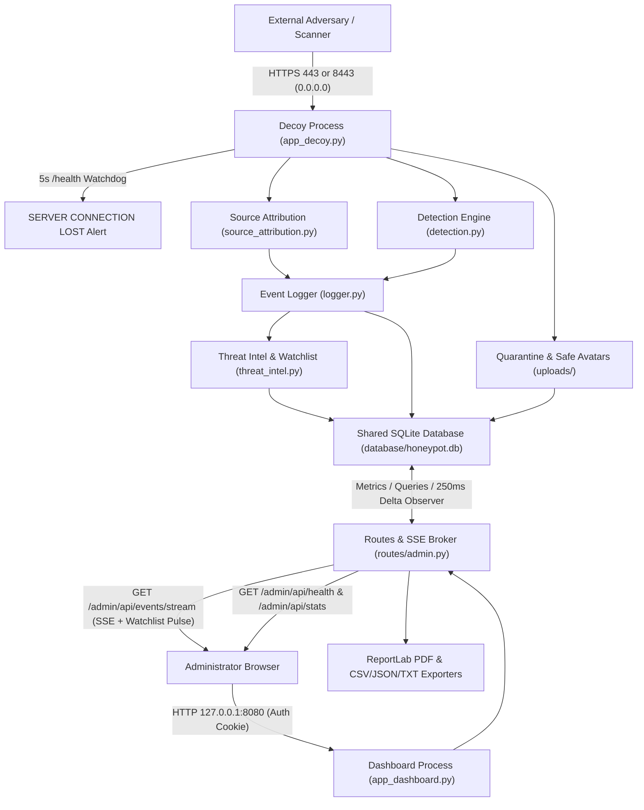

<div align="center">

# 🛡️ BAITSCOPE

### **Cyber Deception & Threat Intelligence Platform — `v5.0`**

***Deceive. Detect. Investigate.***

<br/>

[](https://github.com/BlackVenom7405/honeypot/releases/tag/v5.0)
[](https://github.com/BlackVenom7405/honeypot/commits/main)
[](https://github.com/BlackVenom7405/honeypot/compare/v4.0...v5.0)
[](https://github.com/BlackVenom7405/honeypot)
[](#8-system-requirements)
[](CHANGELOG.md)

<br/>

[](#4-technology-stack)

<br/>

[📖 Overview](#1-project-overview) • [⚡ Capabilities](#3-key-features) • [🏗️ Architecture](#5-system-architecture) • [🎯 Attack Vectors](#6-supported-attack-categories) • [🚀 Quick Start](#9-installation) • [⚙️ Configuration](#10-environment-configuration) • [🔒 Security](#13-security-notes) • [📝 Changelog](CHANGELOG.md)

</div>

---

## 1. Project Overview

**BAITSCOPE** is a dual-process web honeypot and cyber deception platform built with **FastAPI** and **SQLite**. It deploys a realistic public-facing web application (`myTunes` music streaming service alongside legacy trap endpoints) to attract, fingerprint, and trap unauthorized probing while streaming verified threat telemetry to an isolated administrator Threat Operations console.

> [!IMPORTANT]
> Unlike monolithic honeypots that expose management panels alongside decoy routes, **BAITSCOPE isolates the public attack surface (`0.0.0.0:443` / `8443`) from the operator console (`127.0.0.1:8080`)**, synchronizing verified attack logs, zero-trust IP provenance, malware quarantine artifacts, and sub-second Server-Sent Events (SSE) through a shared SQLite database.

### 🔀 Dual-Surface Separation at a Glance

| Surface | Process & Role | Network Binding | Key Capabilities |
| :--- | :--- | :--- | :--- |
| **🎭 Public Decoy Node** | [`app_decoy.py`](app_decoy.py) · `myTunes` Web Player & Legacy Traps | `0.0.0.0` · **HTTPS `443`** *(auto-fallback `8443`)* | Auth flows, magic-byte avatar storage/overlays, `/health` availability monitor, 5-vector detection, sandboxed quarantine |
| **🖥️ Operator Console** | [`app_dashboard.py`](app_dashboard.py) · Threat Operations Center | `127.0.0.1` · **HTTP `8080`** *(localhost isolated)* | `250ms` SSE live stream, System Radar, IP risk scoring (`0–100`), Watchlist badge & pulse, PDF/TXT/JSON/CSV exports |

---

## 2. Objectives

- **Deceive Adversaries Safely**: Serve convincing application responses (`myTunes` web player, auth portals, file uploaders, and API routes) so scanners and attackers continue probing without tipping off defensive telemetry.
- **Detect Five Active Attack Vectors**: Inspect bounded, canonicalized inbound requests and file uploads for **SQL Injection**, **Cross-Site Scripting (XSS)**, **Path Traversal**, **Brute Force**, and **Web Shells**.
- **Preserve Forensic Integrity**: Quarantine suspicious uploads unexecuted inside a strictly contained directory (`realpath` / `commonpath` verification), computing SHA-256 digests and tamper-resistant metadata.
- **Prevent Source IP Spoofing**: Attribute every captured event to its verified TCP socket peer or validated trusted reverse-proxy hop chain before updating threat scores.
- **Deliver Real-Time Operational Visibility**: Push captured telemetry instantaneously over authenticated SSE while distinguishing stream pauses from backend outages via independent health probing.

---

## 3. Key Features

<table>
<tr>
<td width="50%" valign="top">

### 🎭 Deception & Public Portal
- **Realistic `myTunes` Decoy App**: Routes covering `/`, `/signup`, `/login`, `/logout`, `/search`, `/create-playlist`, `/upload-avatar`, `/avatar`, `/delete-avatar`, and `/health`, alongside trap endpoints (`/upload`, `/contact`, `/forgot-password`, `/api/v1/user`, `/client-portal`).
- **WhatsApp-Style Blank Avatar & Translucent Overlays**: Clean default silhouette (`#user-avatar-blank`) when unset, persisted per-user image serving (`GET /avatar`), client-side `onerror` recovery, and conditional frosted translucent hover/focus edit (`POST /upload-avatar`) and delete (`POST /delete-avatar`) circular overlays.
- **Decoy Availability Watchdog**: Lightweight public `GET /health` endpoint monitored by a `5s` client probe displaying a top-centre **`SERVER CONNECTION LOST`** banner after two confirmed failures and clearing automatically on recovery.

### 🔍 Detection & Quarantine
- **Multi-Pass Normalization Engine**: Bounded payload inspection (`MAX_PAYLOAD_LEN = 8192`) and capped URL decode depth (`max_depth = 2`) in [`detection.py`](detection.py) preventing ReDoS stalls.
- **Safe Avatar vs. Malware Isolation**: Verified PNG/JPEG/GIF/WEBP raster uploads are stored under opaque filenames in `uploads/avatars/`, while executable extensions and web shell signatures are isolated in `uploads/quarantine/` with SHA-256 digests.

</td>
<td width="50%" valign="top">

### 🛡️ Attribution, Scoring & Console
- **Zero-Trust Source Attribution**: Attributes real socket peers (`request.client.host`) by default and traverses `X-Forwarded-For` / `X-Real-IP` right-to-left strictly for configured `BAITSCOPE_TRUSTED_PROXIES` CIDRs ([`source_attribution.py`](source_attribution.py)).
- **Deterministic Risk Scoring & Watchlist**: Computes `0–100` IP scores (severity, diversity, velocity, volume, recency decay) in [`threat_intel.py`](threat_intel.py) with SQLite rate limiting (`HTTP 429`), operator notes, and a live sidebar **IP Watchlist count badge** that blinks on newly observed watchlisted activity.
- **Real-Time SSE & Polling Modes**: `GET /admin/api/events/stream` streams live database deltas with monotonic cursors (`Last-Event-ID`), `15s` heartbeats, `Real-time` / timed polling (`10s`–`60s`) / `Manual` intervals, and icon-only manual refresh.
- **System Radar & Forensic Reports**: High-contrast dark & light console UI with idle/attack-driven radar blips, `16`-row live event feed, single-incident payload modal, and **ReportLab PDF**, **TXT**, **JSON**, and **CSV** forensic exports.

</td>
</tr>
</table>

---

## 4. Technology Stack

<div align="center">

[](requirements.txt)
[](requirements.txt)
[](models.py)
[](database.py)
[](requirements.txt)
[](templates/admin.html)
[](templates/admin.html)
[](templates/admin.html)
[](generate_ssl.py)
[](docker-compose.yml)

</div>

<details>
<summary><b>🛠️ Detailed Stack & Module Responsibilities (Click to expand)</b></summary>

| Layer | Technology | Role in BAITSCOPE |
| :--- | :--- | :--- |
| **Language** | Python 3.10+ *(verified on Python 3.12)* | Core backend, security controls, and CLI orchestration |
| **Backend Framework** | FastAPI & Starlette | ASGI routing, auth middleware, dependency injection, SSE streaming |
| **ASGI Server** | Uvicorn | Multi-port HTTP/HTTPS serving (`443`/`8443` and `8080`) |
| **ORM & Database** | SQLAlchemy + SQLite | Attack telemetry, malware hashes, IP registry, decoy users, rate limits |
| **Config & Validation** | Pydantic v2 + `pydantic-settings` + `python-dotenv` | Environment loading and schema contracts |
| **Templating & UI** | Jinja2, HTML5, CSS3, Tailwind CSS, JavaScript | Brutalist Threat Center UI + responsive `myTunes` decoy portal |
| **Live Telemetry** | Chart.js + `EventSource` SSE | 5-vector attack charts, sub-second SSE deltas, health probes |
| **Security & Reporting** | `cryptography` (RSA-3072 TLS), ReportLab | Self-signed X.509 certificate generation & multi-page PDF exports |
| **Deployment & Testing** | Docker, Docker Compose, Vercel, `requests` | Dual-service containers, standalone decoy node, attack simulation |

</details>

---

## 5. System Architecture

BAITSCOPE separates public exposure from administrative control using two independent FastAPI processes coordinated through a shared SQLite database:

1. **Decoy Application ([`app_decoy.py`](app_decoy.py))**: Binds `0.0.0.0` on HTTPS port `443` (falling back automatically to `8443` when `443` is occupied or requires elevation). Serves `myTunes`, validates user avatars, enforces SQLite-backed rate limits, evaluates detection signatures, quarantines malicious uploads, exposes `/health`, and records telemetry via [`logger.py`](logger.py).
2. **Administrator Dashboard ([`app_dashboard.py`](app_dashboard.py))**: Binds `127.0.0.1:8080` over HTTP by default so management views stay isolated on localhost unless intentionally placed behind a reverse proxy or VPN.
3. **Shared SQLite Database ([`database.py`](database.py), [`models.py`](models.py))**: Initializes schema via `Base.metadata.create_all()` and applies idempotent additive migrations via `database.run_migrations()`.
4. **Detection & Threat Intelligence ([`detection.py`](detection.py), [`source_attribution.py`](source_attribution.py), [`threat_intel.py`](threat_intel.py))**: Resolves verified peer IP provenance, updates `ip_threat_registry`, computes deterministic risk classifications (`Low`, `Medium`, `High`, `Critical`), and updates the IP watchlist.
5. **Real-Time SSE & Watchdog ([`routes/admin.py`](routes/admin.py), [`templates/admin.html`](templates/admin.html))**: `RealtimeStreamBroker` polls SQLite deltas (`250ms`) in `Real-time` mode and pushes SSE frames to connected operators while an independent `5s` probe against `GET /admin/api/health` distinguishes SSE interruptions from backend outages.

<details open>
<summary><b>🏗️ Interactive Architecture Diagram (Mermaid Flow)</b></summary>



</details>

---

## 6. Supported Attack Categories

| Vector | Severity | Inspection Scope | Operational Behavior |
| :--- | :---: | :--- | :--- |
| **SQL Injection** | `High` | URL query params, login credentials, search & form fields | Pattern matching after bounded URL decode, HTML entity unescape, and SQL comment normalization; returns plausible decoy failure states |
| **XSS** | `Medium` | Contact forms, playlist creation inputs, search queries | Detects `<script>` tags, inline `on*` handlers, `javascript:`/`vbscript:` schemes, and DOM execution payloads; neutralizes stored decoy playlist names |
| **Path Traversal** | `High` | File query parameters (`/api/v1/user`), uploaded filenames | Flags `../`, `..\`, `%2e%2e`, UNIX/Windows system paths, `file:///` URIs, and UNC administrative share probes |
| **Brute Force** | `Medium` | Repeated failed decoy `/login` submissions per IP | Logs an incident upon reaching `4` consecutive invalid authentication attempts per attributed IP, reinforced by SQLite rate limits (`HTTP 429`) |
| **Web Shell Detection** | `High` | `/upload-avatar` and `/upload` multipart submissions | Enforces bounded `5 MB` streaming reads, catches executable extensions (`.php`, `.jsp`, `.asp`, `.aspx`, `.sh`, `.py`, etc.) & shell primitives, hashes via SHA-256, and quarantines unexecuted |

---

## 7. Project Structure

<details>
<summary><b>📁 Complete Repository Layout (Click to expand)</b></summary>

```plaintext
honeypot/
├── app_dashboard.py                # Admin dashboard FastAPI application & session middleware
├── app_decoy.py                    # Public myTunes decoy FastAPI application & HTTPS server
├── auth.py                         # PBKDF2-HMAC-SHA256 & HMAC session cookie verification
├── database.py                     # SQLAlchemy SQLite engine & idempotent migration helpers
├── detection.py                    # Bounded payload normalization & attack regex engine
├── generate_ssl.py                 # RSA 3072-bit self-signed TLS certificate & key generator
├── logger.py                       # SQLite, JSON, file, and optional webhook attack logger
├── models.py                       # ORM schemas (AttackLog, MalwareMetadata, IPThreatRegistry, User, etc.)
├── report_generator.py             # ReportLab multi-page forensic PDF report generator
├── simulate_attacks.py             # Multi-vector test client covering all 5 active categories
├── source_attribution.py           # Zero-trust peer extraction & trusted proxy chain resolver
├── start.py                        # Dual-process launcher (decoy + isolated admin console)
├── threat_intel.py                 # Weighted threat scoring, watchlist logic, and SQLite rate limiter
├── Dockerfile                      # Container build definition
├── docker-compose.yml              # Dual-service Compose deployment (baitscope_decoy + baitscope_dashboard)
├── firewall_rules.txt              # Sample Windows Firewall rules for ports 443 and 8443
├── requirements.txt                # Runtime Python dependencies
├── vercel.json                     # Optional serverless routing manifest
├── .env.example                    # Sanitized environment configuration template
├── .gitattributes                  # Cross-platform line-ending configuration
├── .gitignore                      # Excludes secrets, databases, logs, quarantine files, and artifacts
├── CHANGELOG.md                    # Dynamic release changelog (Keep a Changelog 1.1.0)
├── README.md                       # Project overview & operational documentation
├── api/
│   └── index.py                    # ASGI entrypoint wrapper for serverless routing
├── routes/
│   ├── admin.py                    # Dashboard routes, /api/stats, /api/events/stream, /api/health, exports
│   └── public.py                   # Decoy portal & public trap routes
├── static/
│   ├── favicon.svg                 # BAITSCOPE vector icon
│   ├── js/
│   │   └── baitscope_api.js        # Authenticated API helper for admin UI
│   └── decoy/
│       ├── styles.css              # Decoy myTunes styles
│       └── images/                 # Decoy media artwork assets
├── templates/
│   ├── admin.html                  # Threat Center dashboard template
│   ├── decoy_home.html             # Decoy myTunes streaming UI (avatars, overlays, /health watchdog)
│   ├── decoy_login.html            # Decoy login page
│   ├── decoy_signup.html           # Decoy signup page
│   ├── forgot_password.html        # Password recovery trap template
│   ├── home.html                   # Platform overview page
│   ├── login.html                  # Administrator authentication gate
│   └── upload.html                 # Decoy configuration upload page
├── decoy_side/                     # Standalone deployable decoy node package
│   ├── README_DEPLOY.md            # Standalone decoy setup guide
│   ├── start_decoy.py              # Standalone node launcher
│   └── ...                         # Decoy server, models, detection, templates & static assets
├── database/
│   └── .gitkeep                    # Runtime SQLite directory (honeypot.db created locally)
├── logs/
│   └── .gitkeep                    # Runtime attack log directory
└── uploads/
    └── quarantine/
        └── .gitkeep                # Isolated malware containment directory
```

</details>

---

## 8. System Requirements

- **Python**: Python `3.10+` *(verified on Python `3.12`)* · **`pip`**
- **Operating System**: Windows, Linux, or macOS
- **Default Ports**:
  - Public Decoy HTTPS: TCP **`443`** *(auto-fallback to TCP **`8443`** if `443` is busy or unprivileged)*
  - Operator Console HTTP: TCP **`8080`** bound to **`127.0.0.1`** by default
- **Optional**: Docker & Docker Compose for dual-container orchestration

---

## 9. Installation

```bash
# 1. Clone the BAITSCOPE v5.0 repository
git clone https://github.com/BlackVenom7405/honeypot.git
cd honeypot

# 2. Create and activate an isolated virtual environment
python -m venv venv
.\venv\Scripts\Activate.ps1    # Windows (PowerShell)
# source venv/bin/activate     # Linux / macOS

# 3. Install runtime dependencies
pip install -r requirements.txt

# 4. Copy environment template and populate unique secrets
cp .env.example .env
```

Optional manual self-signed TLS certificate generation (also run automatically on startup if missing):

```bash
python generate_ssl.py
```

---

## 10. Environment Configuration

Copy [`.env.example`](.env.example) to `.env` and populate strong random secrets before starting in strict/production mode (`BAITSCOPE_STRICT_SECRETS=1`).

<details>
<summary><b>⚙️ Environment Variables Reference (Click to expand)</b></summary>

| Variable | Purpose | Recommended Setting |
| :--- | :--- | :--- |
| `BAITSCOPE_STRICT_SECRETS` | Enforce explicit non-default secrets at startup | `1` in production (`0` for ephemeral dev) |
| `BAITSCOPE_ADMIN_USERNAME` | Single authorized admin username | Custom operator handle |
| `BAITSCOPE_ADMIN_PASSWORD` / `BAITSCOPE_ADMIN_PASSWORD_HASH` | Admin login password or precomputed PBKDF2-SHA256 hash | Strong unique secret / pre-hashed value |
| `BAITSCOPE_ADMIN_SALT` | Password hashing salt/pepper | High-entropy random string |
| `BAITSCOPE_ADMIN_SECRET_KEY` | HMAC-SHA256 key for `gsi_session` admin cookies | 32+ char random string |
| `BAITSCOPE_DECOY_SECRET_KEY` & `BAITSCOPE_DECOY_SALT` | Signing secret and salt for `decoy_session` cookies | High-entropy random strings |
| `BAITSCOPE_DASHBOARD_HOST` / `BAITSCOPE_DASHBOARD_PORT` | Admin dashboard bind address and port | `127.0.0.1` / `8080` |
| `BAITSCOPE_DECOY_PORT` / `BAITSCOPE_DECOY_FALLBACK_PORT` | Public decoy HTTPS port and fallback port | `443` / `8443` |
| `BAITSCOPE_TRUSTED_PROXIES` | Comma-separated proxy IPs/CIDRs trusted for forwarding headers | Unset for direct peers, or proxy CIDR |
| `BAITSCOPE_DATABASE_PATH` | Override SQLite database path | Default `./database/honeypot.db` |
| `MAX_UPLOAD_SIZE_BYTES` | Maximum upload body limit for bounded reads | `5242880` (`5 MB`) |
| `BAITSCOPE_REMOTE_LOG_KEY` | Optional Bearer token for `/api/remote-log` webhook forwarding | High-entropy token when enabled |

*Legacy `SENTINEL_*` environment variables remain supported as fallback aliases.*

</details>

---

## 11. Running BAITSCOPE

### 🚀 Recommended: Unified Dual-Process Launcher

```bash
python start.py
```

On first launch, [`start.py`](start.py) automatically prepares `database/`, `logs/`, and `uploads/quarantine/`, creates/migrates SQLite tables, generates RSA 3072-bit TLS keys (`cert.pem`, `key.pem`) if missing, and starts both servers:

- **Public Decoy App (`myTunes`):** `https://localhost/` *(or `https://localhost:8443/` if `443` falls back)*
- **Admin Threat Console:** `http://127.0.0.1:8080/admin` *(login at `/login`)*

<details>
<summary><b>🐳 Alternative Launch Modes: Individual Services, Docker Compose & Standalone Node</b></summary>

#### Individual Processes
```bash
# Terminal 1: Public Decoy Service (HTTPS)
python app_decoy.py

# Terminal 2: Isolated Admin Console (HTTP localhost)
python app_dashboard.py
```

#### Containerized Deployment ([`docker-compose.yml`](docker-compose.yml))
```bash
docker-compose up --build -d
```

#### Standalone Decoy Node ([`decoy_side/README_DEPLOY.md`](decoy_side/README_DEPLOY.md))
```bash
cd decoy_side
python start_decoy.py
```

</details>

---

## 12. Dashboard Usage

<details open>
<summary><b>🧭 Operator Console Walkthrough (Click to collapse)</b></summary>

1. **Administrator Login**: Open `http://127.0.0.1:8080/login` and sign in with your configured `.env` admin credentials.
2. **Real-Time & Update Modes**: Open **Settings** to toggle `Real-time` (live SSE push stream), timed polling (`10s`, `15s`, `30s`, `60s`), or `Manual`. Use the top-bar refresh icon button (`#manual-refresh-btn`) anytime for immediate synchronization.
3. **Resilient Connection Monitoring**:
   - SSE interruptions degrade automatically to polling (`LIVE STREAM INTERRUPTED — POLLING FALLBACK (5S)`).
   - Genuine backend loss displays a top-centre **`SERVER CONNECTION LOST`** alert and auto-clears on recovery *(both console and `myTunes` decoy site implement independent health watchdogs)*.
4. **System Radar & IP Watchlist Pulse**: System Radar stays cleanly in `SCANNER: IDLE` between events and animates 5-second blips during live activity; the **IP Watchlist** sidebar item tracks total flagged IPs and softly blinks when suspicious events arrive from watchlisted addresses.
5. **Quarantine Vault & Forensic Exports**: Inspect captured SHA-256 digests in **Malware Vault** and export forensic artifacts in **PDF**, **TXT**, **JSON**, or **CSV** formats.

</details>

---

## 13. Security Notes

> [!CAUTION]
> **Authorized Environments Only:** Deploy BAITSCOPE exclusively in networks where you hold explicit authorization to operate cyber deception sensors. Never execute files stored in `uploads/quarantine/`.

> [!WARNING]
> **Secrets & Isolation Hygiene:** Set `BAITSCOPE_STRICT_SECRETS=1` in production, rotate default values in `.env`, keep `BAITSCOPE_DASHBOARD_HOST=127.0.0.1` unless tunneled behind authenticated VPN/reverse-proxy access, and never commit `.env`, `cert.pem`, `key.pem`, `database/*.db`, user avatars, or quarantine samples.

---

## 14. Release & Verification Summary

- **Current Version:** `5.0` (**BAITSCOPE v5.0** · `2026-11-26`)
- **Latest Verified Checkpoints:** Phase 1.1 Security (**24/24 VERIFIED**), Phase 1 Regression (**38/38 PASSED**), Phase 2A Integration (**13/13 PASSED**), Phase 2B Threat Intel & Watchlist (**21/21 PASSED**), Real-Time SSE Suite (**PASSED**), Decoy Avatar & Watchdog Chrome E2E (**PASSED**), Watchlist Badge Chrome E2E (**PASSED**). See full notes in [`CHANGELOG.md`](CHANGELOG.md).

---

## 15. Future Improvements

- Optional Syslog / CEF / Webhook SIEM forwarding adapters for external SOC collectors.
- Offline ASN / GeoIP enrichment database support without outbound cloud API calls.
- Multi-node mutual TLS (mTLS) certificate management for distributed `decoy_side/` sensor fleets.
- Hardware security key (WebAuthn / FIDO2) two-factor authentication option for administrator logins.
